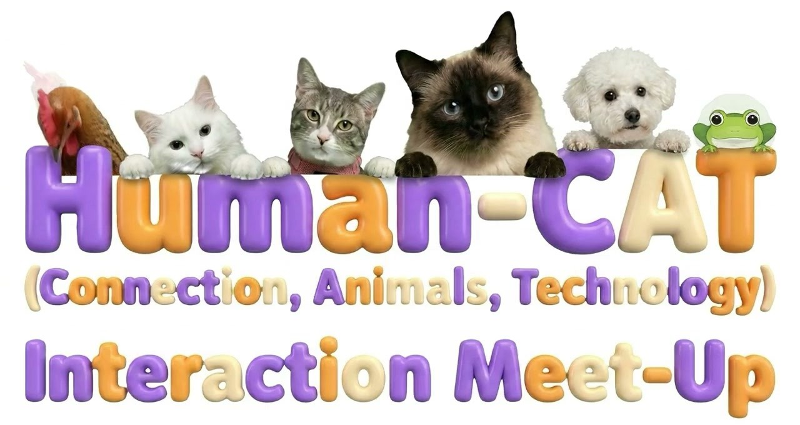

The second Human-CAT Interaction Meet-Up gathers people interested in how technology can support
care, play, communication, and wellbeing between humans and pets, whether physical, robotic, or
digital. The first edition at CHI 2026 drew 60 to 70 people who came and went throughout the
session, so this one at CHI 2027 replaces a fixed schedule with stations that run the whole 90
minutes:

- **Welcome and networking**, with prompt cards to start small-group conversations.
- **Pet gallery and stickers**, where attendees add a photo of their pet to a looping display and
  take home a printed sticker.
- **Design wall**, where attendees turn a moment with their pet into a need, a design, and an open
  research question, and respond to each other's cards.

Two short round-ups give late arrivals a way in, and a final dot vote picks the ideas the group
most wants to pursue. The design wall is published afterward as a growing public record of design
opportunities. More on the [meet-up website](https://humancatinteraction.github.io/).
