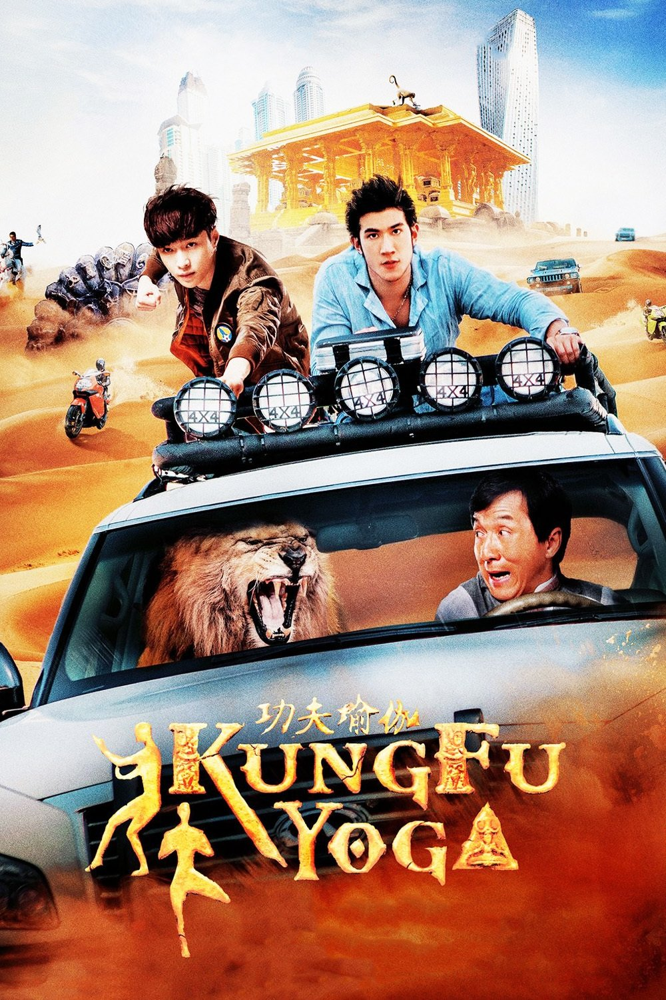

*My VFX compositing showreel · Dexter Studios, 2016-2018*

*Kung Fu Yoga*, directed by Stanley Tong and starring Jackie Chan, is a Chinese-Indian co-production.
I joined the post-production as a **VFX compositor** at **Dexter Studios**.

## Synopsis

An archaeology professor teams up with an Indian scholar to trace a lost Magadha treasure, a hunt that
runs from a Tibetan ice cave to Dubai and India.

