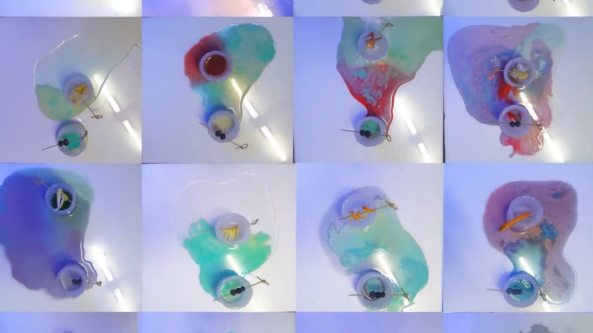

## The recipe rules

The cocktail is *read* from the person rather than picked from a menu. Every drink follows the same
rules, painted on the wall behind the bar:

- **Color:** as close as possible to the guest's favorite color.
- **Scent:** chosen by their sexual identity.
- **Sourness** ∝ how lively they are.
- **Sweetness** ∝ how lonely they are.
- **Bitterness** ∝ how considerate they are of others.
- **Base liquor:** stronger in character the more sociable and leading they are.
- **First taste vs. last taste:** matched when how they see themselves agrees with how others see
  them, mismatched when it does not.

## The bar

A small purple room: bottles lit from below, the rules on one wall, and a monitor playing a video of
the drinks shot from above.

Each guest sat across from me for one conversation and one drink.

The glasses were made of ice, so every portrait started melting the moment it was poured.

## After

By the end of the night every portrait had melted, each into its own puddle of color.

