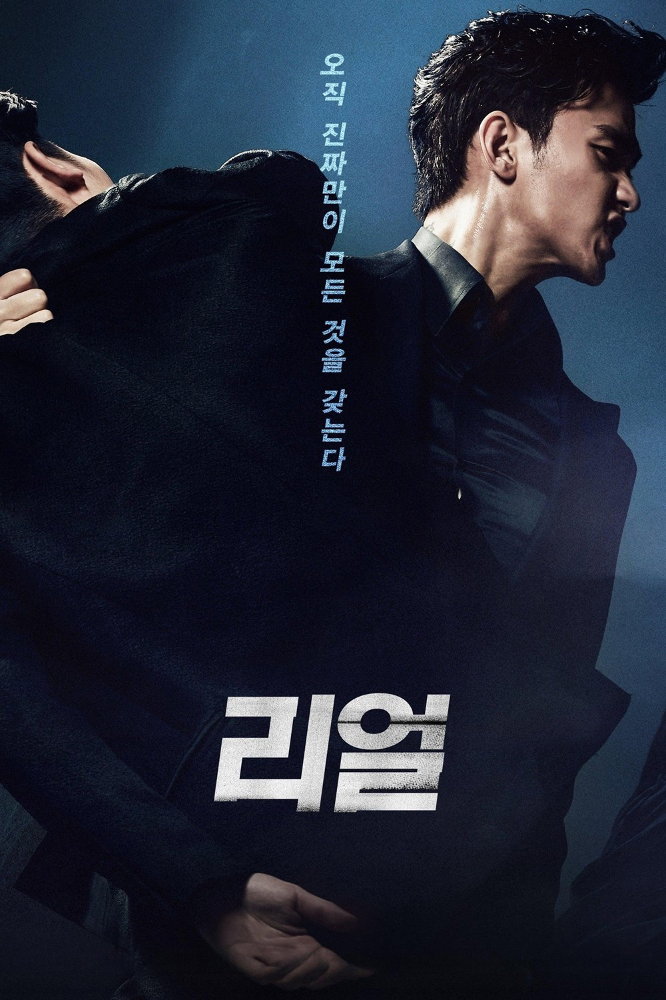

*Real*, directed by Sa-Rang Lee and starring Kim Soo-hyun, is a South Korean neo-noir action thriller.
I joined the post-production as a **VFX compositor** at **Dexter Studios**.

## Synopsis

Jang Tae-yeong, a crime boss about to open a casino, is threatened by an underworld kingpin who claims
the casino as his own. At the same time he is fighting another personality inside himself, and a
treatment meant to erase it brings out a mysterious investor with his name and his face. What follows
is a battle between the real and the fake Jang Tae-yeong.

