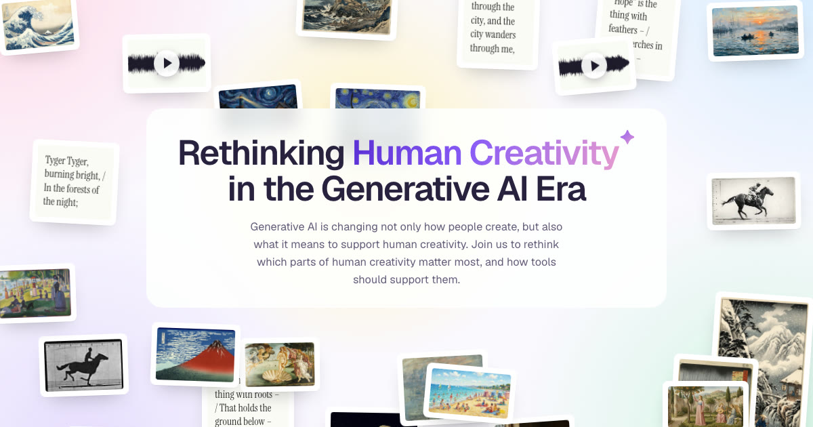

## Why rethink creativity now

Generative AI can produce ideas, feedback, and finished works in writing, images, video, and music.
Because a model can fill the gaps, a good artifact no longer tells us what the person intended,
contributed, or learned. AI help can raise the rated creativity of a work while lowering the
creator's enjoyment, ownership, and confidence. Judging a creativity support tool by its output
alone is no longer enough.

## What happens at the meet-up

The 90-minute meet-up at CHI 2027 brings together researchers who build creativity tools and the
creators who use them.

- **Can You Spot the AI?** (10 min) Small groups, formed by medium (text, image, video, sound),
  look at a spread of works and guess which ones used AI. Then they turn the cards over to see how
  each was made.
- **Share Your Practice** (10 min) Still in their medium group, attendees say which works fooled
  them, then share what they make, which AI tools they use, and where those tools fit in their
  workflow. Sharing is voluntary and can be written on an anonymous card instead.
- **Rethinking Creativity** (50 min) Attendees regroup around the question they care about most
  and write down perspectives, tensions, and open questions for HCI.
  1. *Creative contribution:* Can creativity be shared between humans and AI?
  2. *Delegation:* Which parts of creating do people want to keep for themselves?
  3. *Creative growth:* What does it mean to grow as a creator when more of the creative process
     can be delegated?
  4. *Evaluation:* How do we know whether a tool supports human creativity?

Anyone can share a work, made by hand or with AI, through the
[meet-up website](https://rethinking-creativity.github.io/), even without attending CHI. At the
meet-up, attendees guess which works used AI, then read the maker's note on how each was made.
